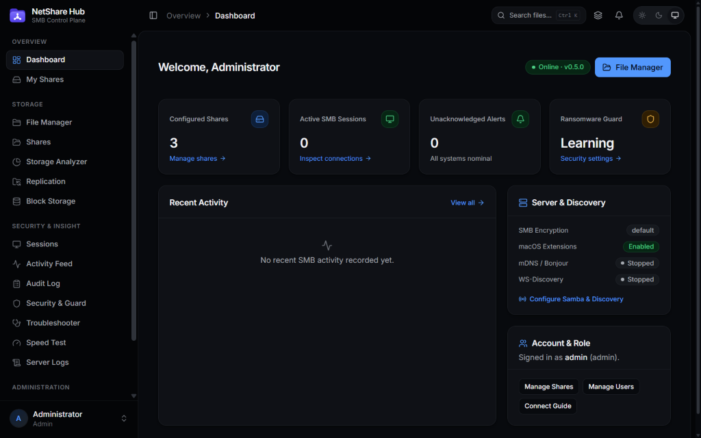
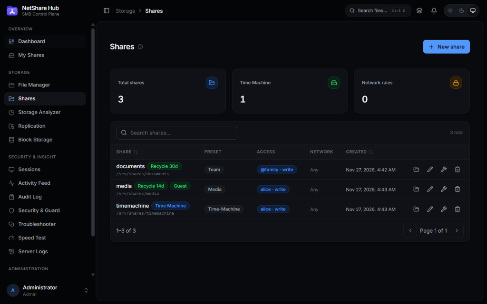
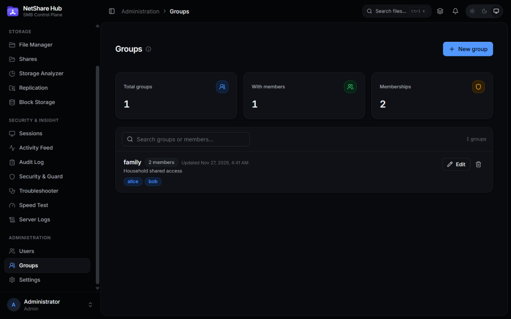
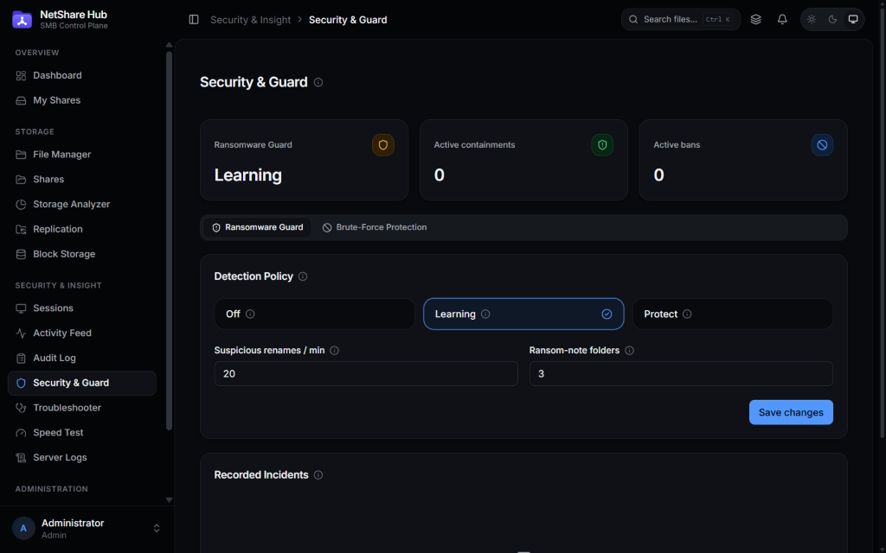
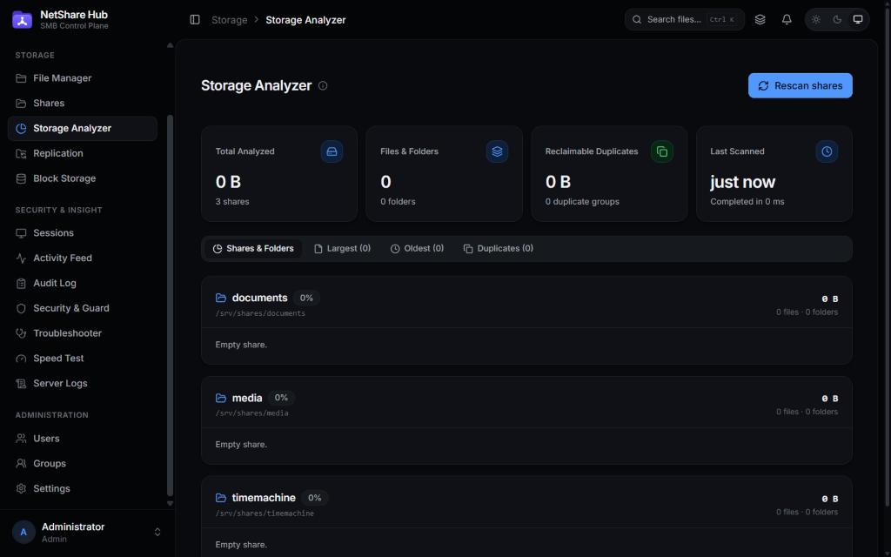
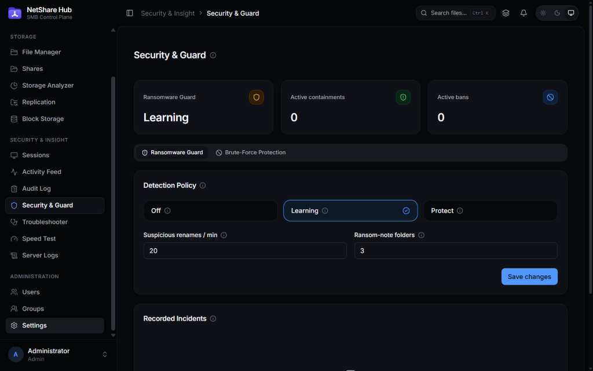

<p align="center">
  
</p>

<h1 align="center">NetShare Hub</h1>

<p align="center">
  <strong>Simple, privilege-separated network file sharing for Proxmox LXC and any Linux.</strong>
</p>

<p align="center">
  
  
  
  
</p>

NetShare Hub is a self-hosted control plane for **Samba (SMB3)**, **NFS**, **Replication**, and **Block Storage (iSCSI / NVMe-oF)** packaged as a single static Go binary with an embedded React web UI and pure-Go SQLite.

It is designed from the ground up for **security and simplicity**: the web server runs unprivileged (`netshare`), OS operations go through a minimal root agent over a peer-credentialed Unix socket, and every web file operation runs inside a per-user `os.Root`-confined file worker under the logged-in user's real Linux UID/GID.

---

## Screenshots

### Control Center Dashboard


### Shares — Presets, Groups, Time Machine, Recycle Bin & NFS


### Linux Groups & Member Picker


### Security — Ransomware Guard & SMB Brute-Force Protection


### Storage Analyzer — Share Breakdown, Largest/Oldest & Duplicate Finder


### Settings — Samba, Discovery, Notification Channels, Task Scheduler & Encrypted Backups


---

## Features

### File Sharing & Storage Protocols
- **Samba (SMB2/SMB3)** — Guided share editor with presets (*Private*, *Team*, *Public read-only*, *Drop box*, *Media*, *Time Machine*), per-user and per-group access matrices, `hosts allow`/`hosts deny` IP/CIDR rules, effective-access preview (`via group`), and atomic `testparm`-validated config reloads.
- **Linux Users & Groups** — One account = web login + Samba login; real Linux groups (`groupadd`/`gpasswd`) with member chip picker and automatic ACL/worker sync.
- **Per-Share Recycle Bin** — Configurable retention (`1–365` days) capturing deletions over both SMB and the web File Manager, with browse, restore, empty, and daily auto-purge.
- **Apple Time Machine & LAN Discovery** — Built-in `catia`/`fruit`/`streams_xattr` support, Time Machine size quotas, and live systemd toggles for **Avahi (mDNS)** and **WS-Discovery (wsdd)**.
- **NFS Exports (optional module)** — Per-share `/etc/exports.d/` management with mandatory client IP/CIDR allow-lists, `root_squash`, and `all_squash` user mapping.
- **Replication (optional module)** — Scheduled local and remote (`rsync` over SSH + `rrsync`) replication with HMAC-authenticated peer pairing, dry-run previews, bandwidth caps, and mirror/keep-deleted modes.
- **Block Storage (optional module)** — Dedicated-disk **iSCSI (LIO)** with CHAP and **NVMe/TCP** targets managed directly via kernel configfs with single-client safeguards.

### Web File Manager & Productivity
- **Virtualized Browser** — Cursor-paginated `@tanstack/react-virtual` table and grid views built for folders with 100k+ entries, right-click context menus, and keyboard shortcuts (`Ctrl+A`, `F2`, `Delete`, `Backspace`, `Enter`).
- **On-Demand Thumbnails** — Pure-Go bilinear image thumbnails and optional `ffmpeg` video thumbnails (auto-detected at startup), read through the user's file worker and cached on disk.
- **Resumable Batch Uploads (tus 1.0.0)** — Web Worker upload engine supporting folder drag-and-drop, pause/resume/cancel, batch-level progress tray, and automatic resume after refresh.
- **Inline Preview & Streaming ZIP** — Lazy-loaded previews for images, video, audio, PDF, and text/code; streamed multi-file ZIP downloads.
- **Global Search (`Ctrl/Cmd+K`)** — SQLite FTS5 cross-share filename index fed by live SMB events + daily rescan, strictly enforcing per-user share access.
- **Storage Analyzer** — Share/folder distribution bars, media categories, largest & oldest files, and exact SHA-256 duplicate finder.
- **User Portal & PWA** — Dedicated `/my-shares` portal with OS-specific connection commands (`\\server\share`, `smb://`, `fstab`), installable offline-shell PWA, and Android Share Target upload handler.

### Security, Diagnostics & Operations
- **Ransomware Guard** — Watches Samba's `vfs_full_audit` stream for mass extension renames and ransom notes; supports *Learning* and *Protect* modes (auto read-only block + client disconnect + one-click restore).
- **SMB Brute-Force Protection** — Tracks failed logins from `auth_json_audit`, escalates ban durations (with IPv4 ARP/MAC tracking for DHCP), and enforces bans via Samba `hosts deny` with an admin allow-list.
- **Three Distinct Logs** — Separate **SMB Activity Feed** (`activity.db`, CSV export), append-only **Admin Audit Log** (SQLite trigger-protected, CSV export), and live **Server Logs** (SSE ring buffer).
- **Diagnostics** — Connection Troubleshooter with **Proxmox LXC mount & UID-mapping checks**, active SMB sessions viewer with disconnect, and built-in **Network + Disk Speed Test**.
- **Notifications & Scheduler** — Multi-tab shared SSE (`BroadcastChannel`) notification center + external **Notification Channels** (**ntfy**, **Gotify**, **Discord/Slack/HTTP Webhooks** with HMAC, **SMTP**), plus a toggleable & reschedulable background task scheduler.
- **Encrypted Backups & Observability** — Argon2id + XChaCha20-Poly1305 `.nshbackup` config export/restore with dry-run validation, automatic pre-migration database backups, `/healthz`, and Prometheus `/metrics`.
- **Modular Surface** — Every optional module can be switched off in `config.toml` (`[modules]`), removing its API routes, background loops, UI navigation, and root agent operations.

---

## Quick Install (v0.5.1)

> **HTTP only, by design:** NetShare Hub serves plain HTTP. Run it on a trusted LAN, or place it behind an HTTPS reverse proxy (Caddy, nginx, Traefik). Over plain HTTP, keep `secure_cookies = false` in `/etc/netshare-hub/config.toml` (or `NSH_SECURE_COOKIES=false` in Docker).

### Option 1: Docker / Docker Compose (amd64 & arm64)

```bash
docker run -d \
  --name netshare-hub \
  --restart unless-stopped \
  -p 8080:8080 \
  -p 445:445 \
  -e NSH_SECURE_COOKIES=false \
  -v netshare-data:/data \
  -v netshare-config:/etc/netshare-hub \
  -v /path/to/shares:/srv/shares \
  ghcr.io/geejayjay/netshare-hub:0.5.1
```

Or using the included [compose.yml](compose.yml):

```bash
docker compose up -d
```

Then open **`http://<server-ip>:8080`** to complete first-run admin setup.

### Option 2: Proxmox LXC / Debian / Ubuntu (Recommended for privilege-separated agent)

1. Install required system packages on Debian 12/13 or Ubuntu 24.04 (including Proxmox LXC):
   ```bash
   sudo apt update
   sudo apt install -y samba samba-common-bin samba-vfs-modules passwd util-linux
   # Optional: LAN discovery for Windows & macOS
   sudo apt install -y wsdd avahi-daemon
   # Optional: video thumbnails in the File Manager
   sudo apt install -y ffmpeg
   ```
2. Download and unpack the `v0.5.1` release tarball for your architecture (`amd64` or `arm64`):
   ```bash
   tar -xzf netshare-hub-0.5.1-linux-amd64.tar.gz
   cd netshare-hub-0.5.1-linux-amd64
   sudo ./install.sh
   ```
3. Open **`http://<server-ip>:8080`** to complete first-run admin setup.

---

## Development & Building from Source

Requirements: **Go 1.25+**, **Node 22+**, **pnpm**.

```bash
pnpm --dir web install
```

Run in development mode (`sys = "fake"` in `config.dev.toml` — no Linux/Samba required; UI at `http://localhost:5173` proxies API calls to `http://127.0.0.1:8080`):

```bash
pnpm dev:api
pnpm dev:web
```

Build a single static binary with the web UI embedded (output in `bin/`):

```bash
pnpm build
```

Useful scripts:

| Command | Description |
|---|---|
| `pnpm test` | Runs Go unit tests, TypeScript typecheck, and ESLint (including architecture boundary rules) |
| `pnpm gen:api` | Regenerates `web/src/shared/api/openapi.json` and `schema.d.ts` from Go Huma routes |
| `pnpm check:api` | Verifies generated OpenAPI spec & TypeScript types are up to date |

### Real Linux / Samba Integration Tests

Run integration tests against real `smbd`, `useradd`, `groupadd`, `exportfs`, and `systemd` inside the Docker test container:

```bash
docker compose -f compose.test.yml run --rm test go test -p 1 -tags integration ./internal/...
docker compose -f compose.test.yml run --rm test bash deploy/test/thin-slice.sh
```

### Local Docker Preview

Preview the full embedded Linux build locally on `http://localhost:8888` with all optional modules enabled:

```bash
docker compose -f compose.preview.yml up -d --build
```

---

## Architecture Overview

```text
cmd/netshare-hub/        CLI entry point (serve, agent, fileworker, openapi, version)
deploy/systemd/          Hardened systemd units (netshare-hub.service, netshare-hub-agent.service)
internal/
  app/                   Application wiring & module feature gating
  agent/                 Privilege-separated root agent over Unix socket (peercred verified)
  fileworker/            Per-user os.Root-confined file worker process
  sys/                   OS abstraction (sysexec for real Linux, sysfake for dev/tests)
  platform/              Shared core (errs, httpx, rbac, db, sse, logger, page, ratelimit, validate)
  modules/               Self-contained feature modules:
                           activity, alerts, audit, auth, backup, block, discovery,
                           files, groups, guard, jobs, notify, replication, scheduler,
                           search, sessions, shares, speedtest, storage, system, thumbs, users
  db/migrations/         Embedded Goose SQL migrations (00001–00023)
web/                     React 19 + Vite + Tailwind v4 + TanStack Router/Query/Table/Virtual
```
